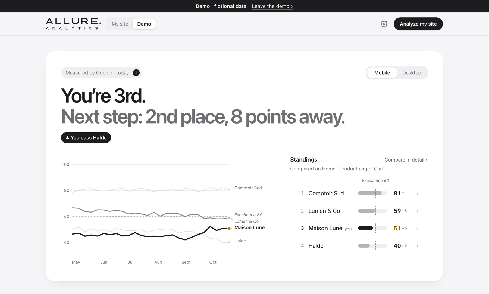
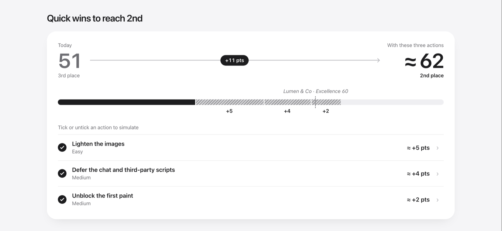
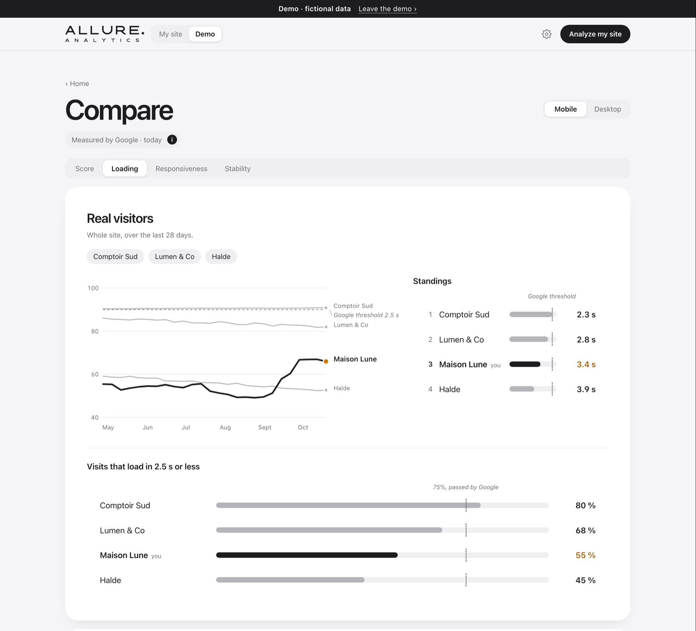

<p></p>

# Allure Analytics

*the pace of your pages · la vitesse de vos pages*

See where your site stands on speed against your competitors, and which quick wins move you up.

**[Try the live demo →](https://emmanuelnsuele-dot.github.io/allure-analytics/#/demo)** &nbsp;  

<picture>
  <source media="(prefers-color-scheme: dark)" srcset="assets/screenshots/home-dark.png">
  
</picture>

## Why

Speed tools hand you a score and a list of audits. A product or marketing lead needs something else: **where the site stands against the competitors customers compare it with**, and what it takes to pass the one just ahead. Allure Analytics measures your key pages and theirs with Google's own data, ranks everyone like for like, and turns Lighthouse's findings into the few quick wins that move you up a place. The conversation starts from your position, not from a list of audits.

## What it does

- **Your position, in one sentence.** "You're 3rd. Next step: 2nd place, 8 points away." Then the PageSpeed curve beside the standings, each score with its change since your last analysis ("+4", "−9", "=" under 2 points).
- **Quick wins as a what-if.** Today on the left ("51 · 3rd place"), the score within reach on the right ("≈ 62 · 2nd place"), the gain between them ("+11 pts"). Tick or untick an action and everything follows live; every combination adds up exactly. The gains are Lighthouse's estimated savings, combined without double counting and rescored like PageSpeed. Nothing is saved: it's a visualisation tool, not a task tracker.
- **Compare in depth.** Indicator by indicator: real visitors first (6-month Chrome UX Report curves for every site, standings on the real value, the share of good visits against Google's 75% mark), then the lab page by page, each value opening Google's own report. The Score tab shows where each site's points go.
- **Google's numbers, exactly.** The PageSpeed score is recomputed with Lighthouse's official scoring, to the rounding, so it matches PageSpeed Insights. Excellence sits at 60 on mobile and 80 on desktop, already a very high level on Google's machine (Google keeps its green for 90 and above). A "Measured by Google ⓘ" pill explains how the score is made, including why Lighthouse in your own Chrome scores higher: a faster processor, so JavaScript blocks the page less.
- **Honest with missing data.** Like-for-like comparisons only (the pages measured for you *and* each competitor), a tie under 2 points, and a plain state for every gap: no competitor, a failed page, a small site without real-visitor data, a one-point history.
- **Moments that mean something.** Your rank rolls like a counter when it changes, the standings slide into place, a place won glints across your bar. An analysis that ends on screen lands with your position very large in the middle, which then settles into the sentence.
- **Zero dependencies, no build step.** Native ES modules and hand-drawn SVG; French and English, light and dark, phone to desktop.

<p></p>
<p></p>

## Run it

```bash
node serve.mjs
```

Then open http://localhost:4173. ES modules don't load from `file://`, which is why a tiny server is needed; `serve.mjs` uses only Node built-ins. Any static host works too: the live demo is plain GitHub Pages.

The app opens on the real product: a clean welcome until your first analysis. The demo (a fictional shop and its competitors) is one click away, from the welcome screen or the *My site | Demo* switch in the top bar; a dark band across the top says you're in it, with *Leave the demo* to come back.

**Share links:** `#/demo` opens the demo directly, `#/demo/compare/lcp` opens it on a given screen, and `?lang=en` or `?lang=fr` picks the language, e.g. `https://emmanuelnsuele-dot.github.io/allure-analytics/?lang=en#/demo`.

## Your Google key

To measure your own site (as a whole, or 1 to 8 key pages, against up to 8 competitors), click **Analyze my site** and follow the four steps of the *Google key* card. It is one free Google Cloud API key, with two APIs switched on:

| API on the key | What it unlocks | Without it |
|---|---|---|
| **PageSpeed Insights API** (required) | The lab: score, standings, curve, quick wins, page-by-page lab in Compare, plus a copy of real-visitor data without history | No analysis (PageSpeed grants no quota without a key) |
| **Chrome UX Report API** (recommended) | Real visitors from the source: current values, share of good visits, and 6 months of weekly history in Compare | The analysis still runs; real visitors come from PageSpeed, without history |

Each step links to the right page of the Google Cloud console. As soon as the key is pasted, Allure checks it with one light request per API (nothing is measured) and ticks the steps itself; once both APIs answer, the card folds into one line.

## Privacy

- No server, no account, no analytics: Allure Analytics is a set of static files.
- Your project, your results and your key stay in your browser's local storage, on your device.
- Your key is sent only to Google's APIs (PageSpeed Insights and Chrome UX Report), which measure public pages.
- *Settings › Delete my data* wipes everything.

## Status — v0.1

| Done | Next |
|---|---|
| Home: your position, curve and standings, quick-wins simulator, page bars | Page sheet: causes, history, page-to-page comparison |
| Compare: score breakdown, real visitors, lab page by page with links to Google | Action sheet: the why, the pages, a ready-to-paste ticket |
| Real analysis: PageSpeed + CrUX, light progress screen, a curve point per analysis, one-click re-run | Scheduled weekly runs (phase 2: shared backend) |
| Settings: project, Google key with a live check, language, theme, delete my data | Printable A4 brief, CSV export |
| Demo one click away, FR / EN, light / dark, phone to desktop, several tabs | |

The full product decisions, with every edge case studied before building, are in [SPEC.md](SPEC.md) (in French). Changes are listed in [CHANGELOG.md](CHANGELOG.md).

## Tests

```bash
node --test tests/
```

Plain Node 20, no dependencies, no key and no network: Google's APIs are mocked with realistic PageSpeed Insights and CrUX answers. The tests run real analyses end to end (redirects, failed pages, missing field data, a disabled CrUX API, daily quota, storage quota, an aborted run…), render the home and Compare screens on both devices and in both languages and fail on any broken value, check every answer the key check can get from Google, and prove that each combination of the quick-wins simulator adds up exactly. They run on every push (GitHub Actions).

## Structure

```
index.html · styles.css · serve.mjs
src/
  app.js          state, routing, toggles, sync across tabs
  api.js          PageSpeed Insights v5 and CrUX clients: concurrency limits, retries, key check
  analyze.js      a real analysis → the same data shape as the demo, plus notes
  project.js      setup and its checks, saved results, lab history, run lock
  url.js          address normalisation, stable ids
  storage.js      the single persistence boundary (localStorage → backend in phase 2)
  metrics.js      thresholds, Lighthouse scoring, audit catalogue
  prioritize.js   findings → ranked fixes
  benchmark.js    position: like-for-like comparison, standings, ties, gains, rank history, since last time
  demo.js         seeded demo project
  i18n.js         FR / EN strings and formatting
  charts.js       SVG race chart (gaps allowed), icons
  html.js         escaping
  logo.js         the Allure Analytics logotype, drawn as paths
  views/          shell, welcome, home, compare, analyze (setup and run), settings, notes, stubs
tests/            end-to-end and unit checks on mocked Google APIs
tools/            build-logo.mjs (assets/*.svg), screenshots.sh (README images, share card)
```

## Contributing

Ideas and bug reports are welcome: see [CONTRIBUTING.md](CONTRIBUTING.md).

## License

MIT © Emmanuel Nsuele. See [LICENSE](LICENSE). Designed and built by [Emmanuel Nsuele](https://fr.linkedin.com/in/emmanuel-nsuele).
